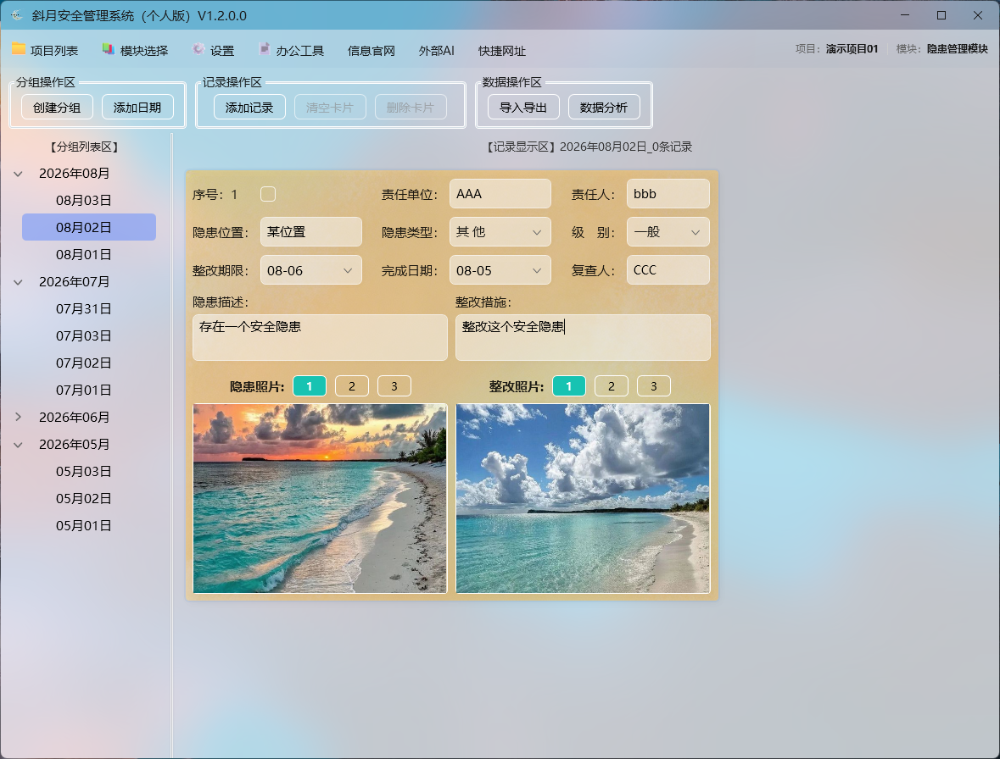
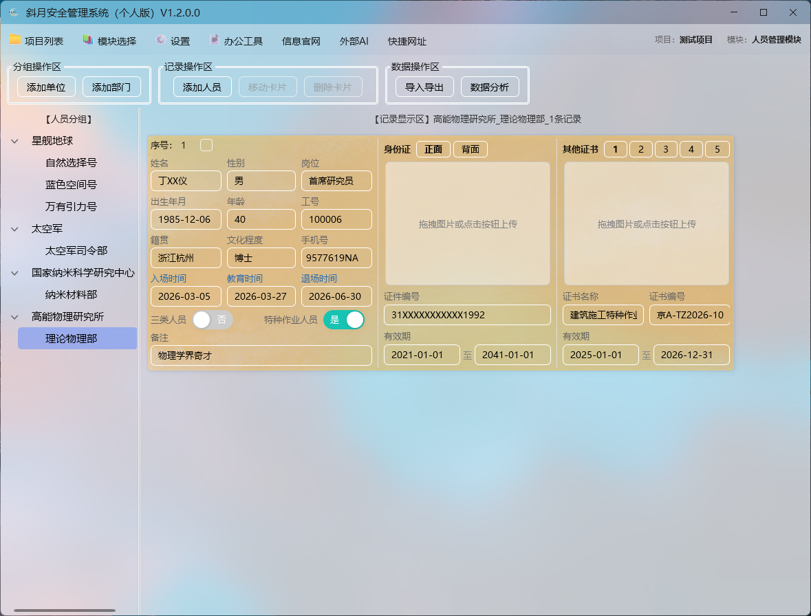
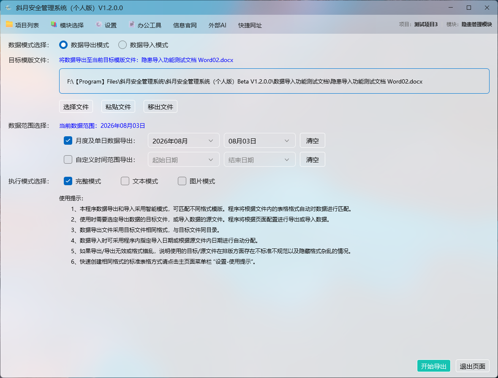
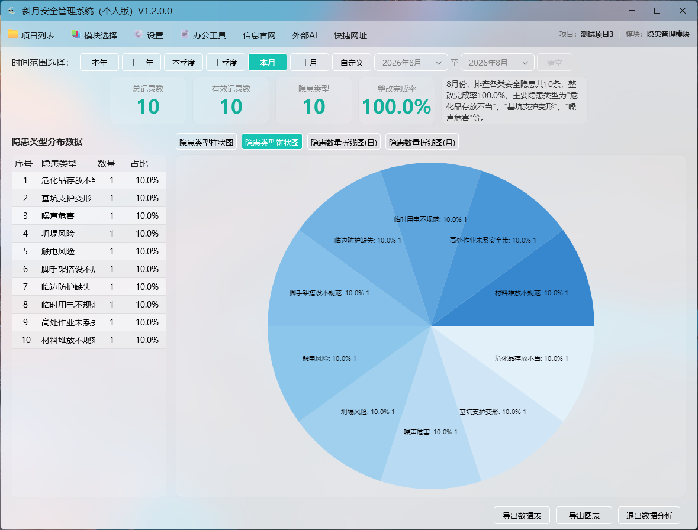
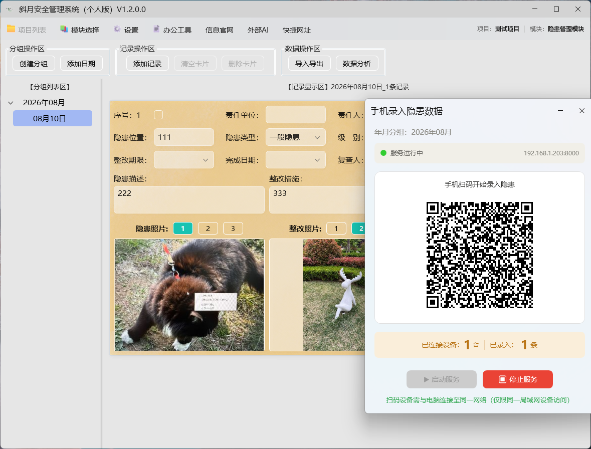
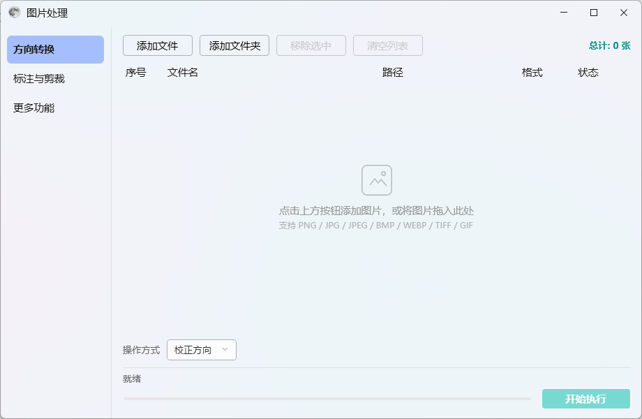
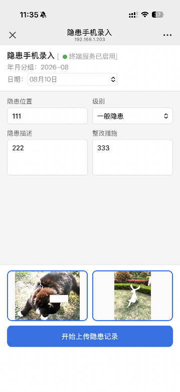
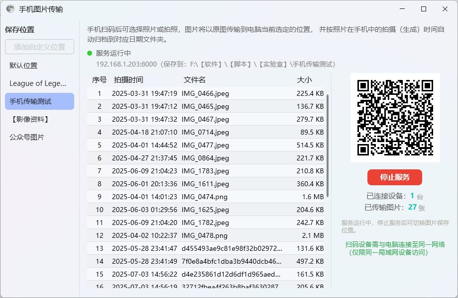
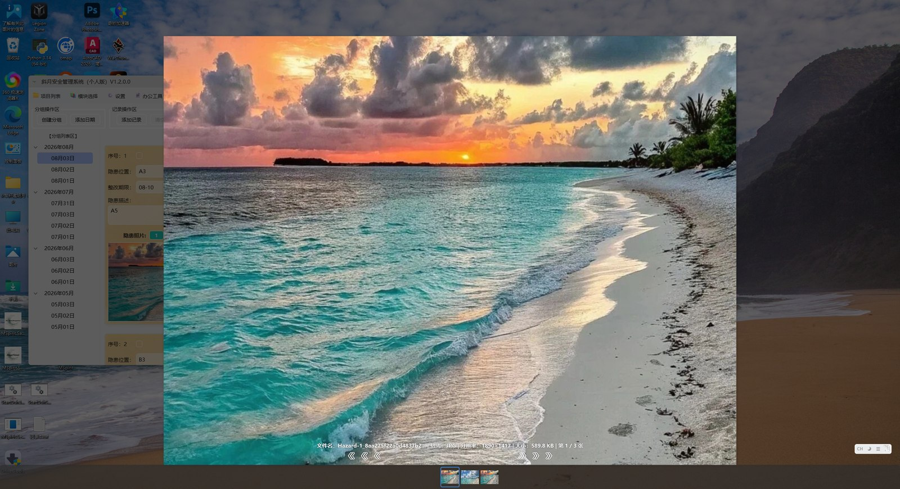
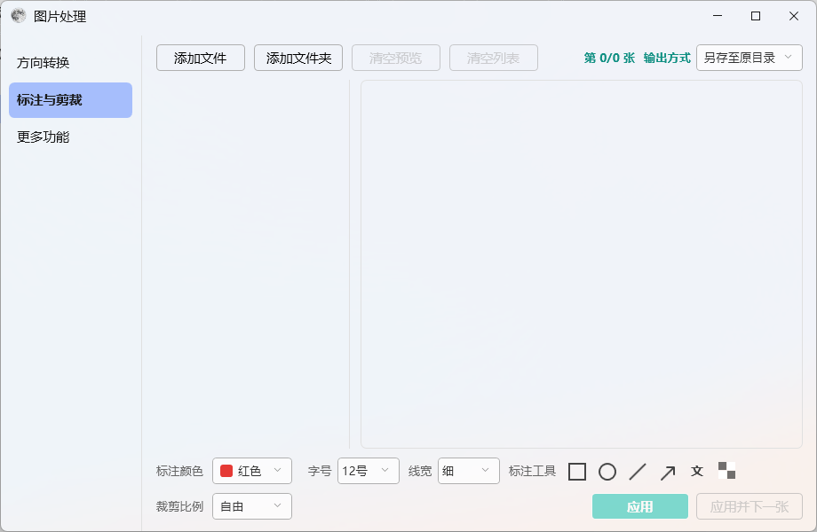

# MS_SafetyManagementSystem (斜月安全管理系统)

   

> **简体中文（Chinese）**：[docs/README.md](docs/README.md)

A local desktop safety management system for safety management in physical-industry enterprises (construction, manufacturing, production, etc.) — daily safety inspection records and personnel management. Currently **Personal Edition V1.2** (version 1.2.0.0).

## Features

| Module | Description |
|---|---|
| Hazard Management (Hazard) | Safety inspection hazard recording and tracking: title/description/hazard type/level/responsible unit/responsible person/location/rectification measures/deadline/status; up to 6 images per record (3 hazard + 3 rectification photos); cards can be moved/copied to other date groups |
| Personnel Management (Personnel) | Personnel profile management (name/gender/age/hometown/ID card number, etc.) with ID card/certificate photo attachments; **LAN entry**: scan a QR code with a phone, take photos, and PaddleOCR auto-fills ID card fields |
| Image Viewer (ImageViewer) | Built-in viewer: fullscreen, zoom (Chase engine), rotate/flip, thumbnails, slideshow |
| Smart Import/Export (Export) | Field-matching import/export based on Word/Excel templates; auto-generates rectification reports and other documents |
| Statistics & Analysis (Analysis) | Monthly hazard/personnel statistics charts (LiveChartsCore) |
| Image Processing (ImageProcess) | Image orientation conversion (rotate left/right/180°, flip, EXIF auto-correct) + **Annotate & Crop** (six annotation tools: rectangle/oval/line/arrow/text/mosaic, output together with cropping) |
| Others | System tray minimize, single-instance protection, seasonal theme backgrounds + solar-term calendar, QR code generation, context-menu shortcuts |

## Screenshots

<p>
  
  
</p>
<p>
  
  
</p>
<p>
  
  
</p>
<p>
  
  
</p>
<p>
  
  
</p>

## Maintenance status

This project is developed and maintained by **a single author** (AXin / 斜月Spirit) in spare time, so updates come at **irregular intervals**.

- Bug reports, feature suggestions and usage questions are welcome — please open an [Issue](https://github.com/MoonSpiritX/MSpirit.SafetySys/issues) using the provided templates.
- **No additional maintainers are being added, and external pull requests are not accepted at this stage.** If you have a concrete idea for a code change, open an issue first; the author will decide whether and how to implement it.

See [CONTRIBUTING.md](CONTRIBUTING.md) for details and other ways to reach the author.

## Tech Stack

- **Framework**: .NET 10 (`net10.0-windows10.0.17763.0`) + WPF
- **UI**: WPF-UI 4.3.0 (Fluent Design style)
- **MVVM**: CommunityToolkit.Mvvm 8.2.2 + Microsoft.Extensions.DependencyInjection
- **Data**: Microsoft.Data.Sqlite 8.0.0 + Dapper (all parameterized queries, WAL mode)
- **OCR**: Sdcb.PaddleOCR + ONNX Runtime + OpenCvSharp4
- **Document Export**: ClosedXML (Excel), DocumentFormat.OpenXml (Word), SkiaSharp (image compression)
- **Charts**: LiveChartsCore.SkiaSharpView.WPF
- **LAN Service**: Kestrel (ASP.NET Core, built-in HTTP server, binds without UAC elevation)
- **Logging**: Serilog (rolling file, 7-day retention)
- **Others**: QRCoder, Hardcodet.NotifyIcon.Wpf, Microsoft.Xaml.Behaviors.Wpf

## Requirements

- Windows 10 1809 (build 17763) or later, or Windows 11
- Development/build: Visual Studio 2022 (with .NET desktop workload) or .NET 10 SDK

## Build & Run

```bash
# Run (debug)
dotnet run --project MS_SafetyManagementSystem.csproj

# Build
dotnet build MS_SafetyManagementSystem.csproj -c Debug

# Unit tests (MSpirit.SafetySys.Tests, xUnit)
dotnet test MSpirit.SafetySys.Tests/MSpirit.SafetySys.Tests.csproj

# Publish (example: win-x64 self-contained; output under bin/Release/net10.0-windows10.0.17763.0/publish/win-x64/)
dotnet publish MS_SafetyManagementSystem.csproj -c Release -r win-x64 --self-contained true
```

You can also open `MSpirit.SafetySys.slnx` in Visual Studio and press F5.

## Data Storage & Backup (Important)

- **Data root**: defaults to `{drive}\MSpirit.SafetySys.Date` on the first available non-system fixed drive (alphabetical order D→E→F…); falls back to `%LOCALAPPDATA%\MSpirit.SafetySys.Date` when no such drive exists. The startup flow remembers the last used data root and can guide recovery (manual pick / full-disk search) if it goes missing (e.g. drive unplugged or drive letter changed). See `Services/DataRootLocator.cs`.
- **Databases**: `master.db` at the data root (project list); each project's data in `ProjectsDate\Project_{id}\data.db`.
- **Attachments**: `ProjectsDate\Project_{id}\{module}_{yyyy-MM}\Card_{recordId}\`, thumbnails in the `thumb\` subfolder.
- **Logs**: `logs\debug*.log` next to the program (daily rolling, 7-day retention).
- **Automatic backup**: the program backs up databases and configs to the `ProjectsDate.Backup` folder (under the data root) on startup and shutdown, keeping backups for the latest 30 days (capped at 100 copies). For long-term backup, close the program and copy the entire data root (including `master.db` and `ProjectsDate`), or export a `.msarch` archive package from "Project & Archive Management".

## Project Structure

```
MS_SafetyManagementSystem/
├── LICENSE                 # AGPL-3.0 license text
├── THIRD-PARTY-NOTICES     # Third-party component licenses
├── App.xaml(.cs)            # Entry point, DI container, global exception handling, Serilog setup
├── MainWindow.xaml(.cs)     # Main window (layout, command dispatch)
├── MainWindowViewModel.cs   # Main view model (project/module switching)
├── Models/                  # Data models (Record, PersonnelRecord, Attachment, Group, etc.)
├── ViewModels/              # View models (RecordsViewModel, etc.)
├── Views/                   # Common windows (move/copy, project management, link management, etc.)
├── Hazard/                  # Hazard module (record cards, photo handling, interactions)
├── Peoplemanagement/        # Personnel module
├── ImageViewer/             # Built-in image viewer
├── Export/                  # Word/Excel import & export
├── Analysis/                # Statistics & analysis
├── Services/                # Data access and business services (ProjectDbContext, ProjectDataService, LanService, etc.)
├── Helpers/ Converters/ Controls/ Tools/ Common/   # Utilities and shared code
└── docs/                    # Project documentation (this file, ISSUES.md, etc.)
```

## Known Issues

- Half-finished code (`Controls/FluentPopup.cs`, `Controls/WindowMaterial.cs`, and a backup MainWindow) has been removed (cleaned up on 2026-08-14; the csproj exclusions were removed along with the files).
- A few files are still large (e.g., `ImageViewer/ImageViewerWindow.xaml.cs` ~1,400 lines, `ViewModels/GroupTreeViewModel.cs` ~1,400 lines); see `docs/ISSUES.md` for the current list. `MainWindow.xaml.cs` was split into 10 partial files in Aug 2026 (largest: ~400 lines each).
- A unit test project now exists (`MSpirit.SafetySys.Tests`, xUnit, 703 tests covering core data-layer logic, the import/export pipeline (Excel & Word), the data-root locator, the project/archive/backup services, the statistics/analysis view models, and the image crop/annotation tooling); historical data may contain a few missing attachment files (see `docs/ISSUES.md`).

## Open Source License & Commercial Licensing

> **Status**: the source code is **publicly available** in this repository, released under `AGPL-3.0-or-later`. The license statements below are in effect.

This project is released under the **GNU Affero General Public License v3.0 (`AGPL-3.0-or-later`)**, copyright AXin (斜月Spirit). The full license text is in the root [`LICENSE`](../LICENSE).

Quick summary for non-developers:

- **Free to use**: individuals and organizations may download, install, and use the software for free.
- **Attribution required**: preserve the copyright notice and this license when copying, modifying, or redistributing.
- **Modifications must be open-sourced**: if you modify the source and distribute it, or provide a modified version over a network service, you must release it under AGPL-3.0 and provide the corresponding source code.
- **Internal use only**: purely internal use without modification, distribution, or network service does not trigger the open-source obligations.

Third-party component licenses are listed in the root [`THIRD-PARTY-NOTICES`](../THIRD-PARTY-NOTICES).

**Privacy policy** (for store submission and general reference): <https://github.com/MoonSpiritX/MSpirit.SafetySys/blob/master/docs/PRIVACY_POLICY.md>

**Commercial licensing**: companies/organizations that need closed-source integration, commercial distribution, or an exemption from AGPL obligations may contact the author (AXin / 斜月Spirit).

## Related Documents

- [CONTRIBUTING.md](CONTRIBUTING.md) — Contribution guidelines (Chinese)
- `docs/ISSUES.md` — Known issues and improvement suggestions (Chinese)
- `docs/数据架构.md` — Database schema, directory layout, and path rules (Chinese)
- `docs/用户手册.md` — User manual for everyday use (Chinese)
- `docs/LAN服务技术文档.md` — LAN services (personnel/hazard phone entry, photo transfer, update IPC) architecture & protocol (Chinese)
- `docs/开源许可中文参考.md` — Unofficial Simplified Chinese translation of AGPL-3.0 (the English original in the root `LICENSE` governs)
- `docs/PRIVACY_POLICY.md` — Privacy policy (bilingual, for store submission and open-source release)
